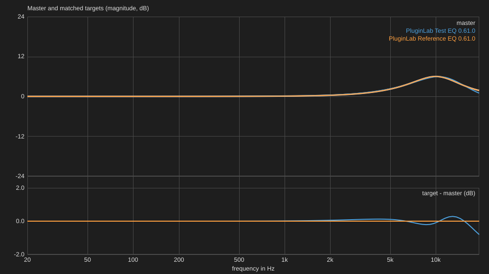

# Same knobs, different designs: Orfanidis against RBJ

A teaching case of the matcher (W9.7). Background on the two designs:
[references/orfanidis-and-cramping.md](references/orfanidis-and-cramping.md) and
[references/rbj-cookbook.md](references/rbj-cookbook.md). How the matcher works:
[../matching/plugin-matching.md](../matching/plugin-matching.md).

## The question
Two EQs with the knobs at the same numbers (a peak at 10 kHz, +6 dB, Q 1) do
not give the same sound when their designs differ. Can the knobs of one be
set so that it sounds like the other? The matcher answers by measurement: it
moves the knobs until the magnitude responses agree, or says why they cannot.

## The experiment
- Master: the Orfanidis peak at 10 kHz, +6 dB, Q 1 (a band-model curve, 48 kHz).
- Target 1: the Test EQ, an RBJ peak (gain, frequency and Q released).
- Target 2: the Reference EQ with its algorithm switched to "Orfanidis" by
  the user (frequency, gain and Q released, the start from its mapping).
- Tolerance strict (0.1 dB), 20 Hz ... 19.3 kHz.

```json
{
  "master": {"curve": [{"family": "Orfanidis", "type": "peak", "frequency": 10000, "gain": 6, "q": 1}]},
  "targets": [
    {"plugin": ".../PluginLabTestEq.vst3", "release": ["Gain", "Frequency", "Q"]},
    {"plugin": ".../PluginLabReferenceEq.vst3", "release": ["Frequency", "Gain", "Q"],
     "start": {"Algorithm": 0.1666667, "Type": 0.75}, "modelStart": true}
  ],
  "tolerance": "strict"
}
```
(`PluginLabHost --match job.json report.md`, or the page Matcher.)

## The result


| Target | Result | Largest / rms deviation | Null depth | Found setting |
|---|---|---|---|---|
| Test EQ (RBJ) | not within 0.1 dB | 0.81 / 0.12 dB | -28.2 dB | Gain 5.94, Frequency 10436, Q 0.64 |
| Reference EQ (Orfanidis) | matched | 0.000 / 0.000 dB | identical | Frequency 10000 Hz, Gain 6.0 dB, Q 1.00 |

Why not closer, for the RBJ: "another design family: the master's band is
Orfanidis peak 10000 Hz +6.0 dB, the target's RBJ cookbook peak 10436 Hz
+5.9 dB; the designs differ most at 19331 Hz".

## What it shows
- **The RBJ peak cannot be an Orfanidis peak near Nyquist.** The bilinear
  transform squeezes the RBJ band towards half the sample rate ("cramping"):
  its gain falls to 0 dB at Nyquist, the Orfanidis design keeps the gain of the
  analogue prototype there. The best RBJ setting moves the band up (10436 Hz)
  and widens it (Q 0.64) to follow the master below 10 kHz and still misses by
  0.8 dB at 19 kHz (the blue difference curve).
- **Knob numbers do not transfer between designs:** the best RBJ setting is not
  "10 kHz, +6 dB, Q 1".
- **The same design matches exactly**, sample for sample (null depth:
  identical).
- **A magnitude match is not a null:** within 0.8 dB, the RBJ still leaves a
  residual of -28 dB against the master: the phases differ too.

Listen: load the Test EQ and the Reference EQ on the page Plugins, match them
on the page Matcher, apply, and switch between them on the page Compare (a
bright recording shows the difference above 10 kHz best).

## Later
A Butterworth low-pass against a matched (Nyquist-matched) design: the same
question for a pass filter, once the band model has the matched family.
